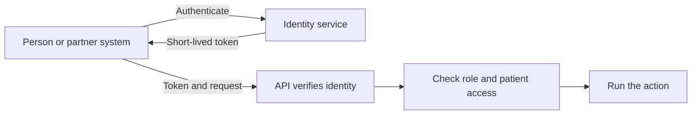
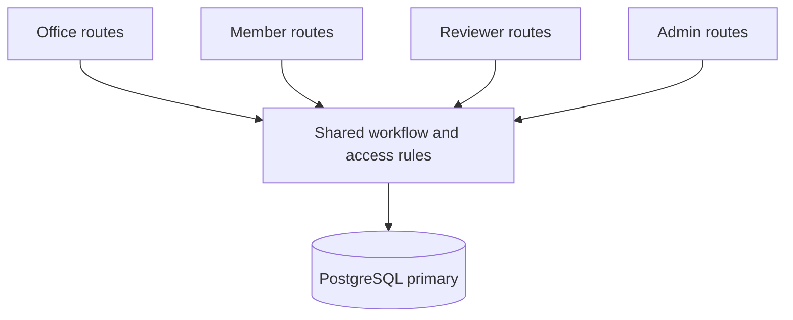
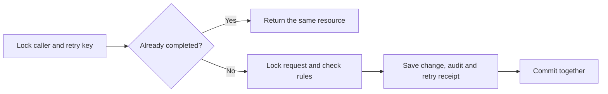

# A few design choices

## Know who is calling, then decide what they can do

A person signs in through the identity service. A partner system gets a token for its service identity. The API verifies the signature, issuer, audience and expiry, then checks the subject against our stored role and relationships. A role in a token alone does not grant access to every patient.

This follows the distinction between [user and service principals](https://learn.microsoft.com/en-us/entra/identity-platform/app-objects-and-service-principals). Here `partner-maine` is a service principal with office permissions. For the API's own access to cloud resources, use a workload identity such as an [AWS task role](https://docs.aws.amazon.com/IAM/latest/UserGuide/id_roles.html). “Resource principal” varies by provider; it is that workload-identity idea, not another patient-facing role.

The local token script stands in for the identity service. It is not a login endpoint. Real issuer integration is [issue #2](https://github.com/spfuzzylink/prior-auth-api-challenge-submission/issues/2).

## Keep the workflow in one place

Each group can change its routes and response models independently. A request-scoped `PriorAuthorizationService` holds the verified caller and database connection. Its methods enforce workflow permissions for HTTP and internal callers alike. Members have a safe response model, and office responses also exclude reviewer reasoning.

`IdempotentWrite` owns the retry key, fingerprint and receipt. It uses the service's transaction; it does not commit independently. The HTTP adapter maps workflow errors to responses and records safe diagnostics. These are concrete classes with small jobs; another internal HTTP service or a repository hierarchy would add little here.

## Finish the write with its history

Submission creates a new request; claim, decision and reassignment lock an existing row. Only one reviewer wins competing claims. A changed payload with an old key gets `409`.

Database triggers append history and reject changes without an actor and trace ID. Deferred constraints require every procedure outcome and its assigned deciding reviewer at commit. A failed audit insert rolls back the decision. Final decisions and audit rows cannot be edited through ordinary SQL.

Support has a separate PHI-free call record: request ID, actor, route template, status and error codes, including rejected submissions. The same metadata goes to logs during a database outage. Tokens, notes, diagnoses and raw bodies stay out of logs. A database owner can bypass triggers; protected audit exports are [issue #3](https://github.com/spfuzzylink/prior-auth-api-challenge-submission/issues/3).

## Read more, write less

Lists are capped at 100 and fetch procedures in one batch. GETs use a consistent snapshot on the primary. Writes return after commit. An earlier GET can still return its earlier snapshot; issue a fresh GET after a successful write.

Replica lag, cache invalidation and high-volume freshness guarantees are [issue #1](https://github.com/spfuzzylink/prior-auth-api-challenge-submission/issues/1). Measure demand and agree on the contract before building them.
